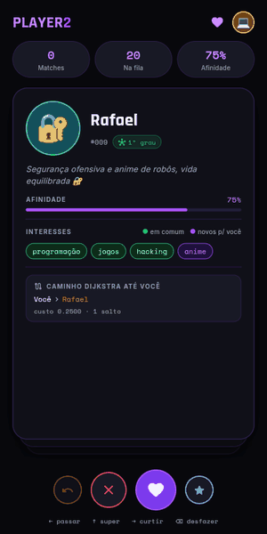
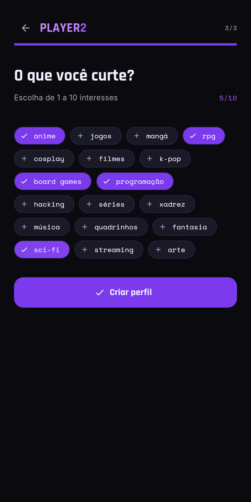
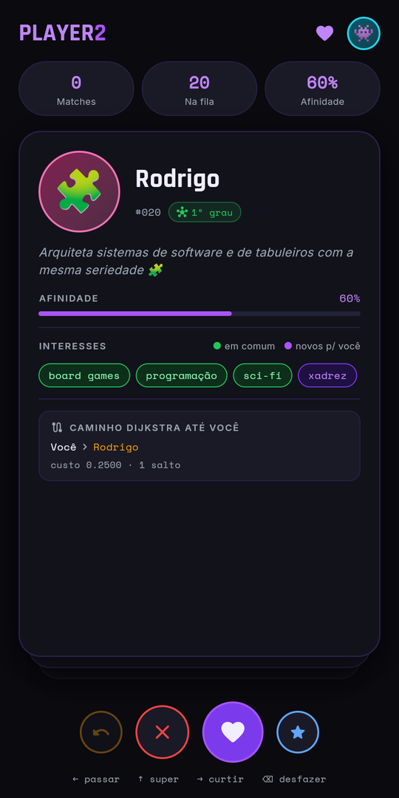
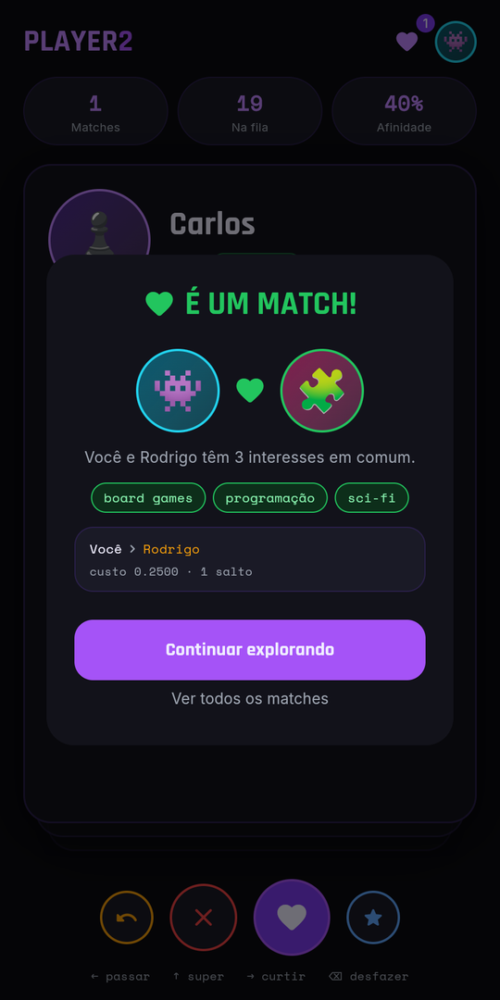
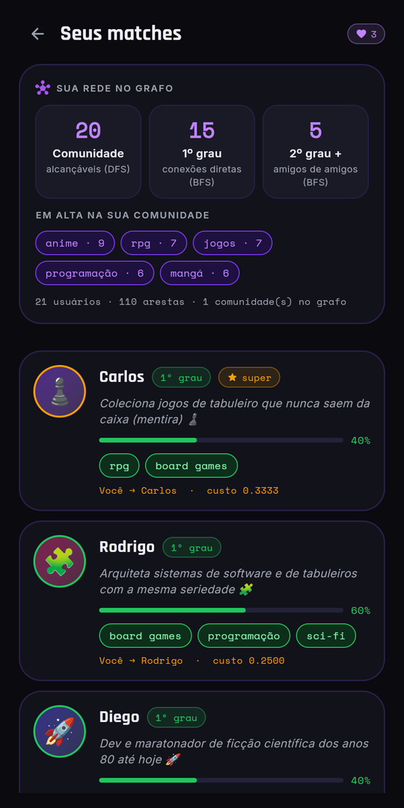

# Player2 🎮

> *Encontre seu player 2: o app de matchmaking geek feito com grafos.*

Interface estilo Tinder para conectar pessoas por interesses em comum, como anime, RPG, jogos, k-pop e programação. Por baixo dos cards e dos likes, roda um sistema de grafos com Dijkstra, BFS e DFS que decide quem você deveria conhecer.

### ▶ [Experimente a demo no navegador](https://educofseal.github.io/Player2/)

Funciona no computador e no celular, inclusive no iPhone ([veja como instalar](#no-iphone)). Na demo, experimente entrar como **João**, **Ana** ou **Pedro**.

<p align="center">
  
</p>

<table>
  <tr>
    <td align="center"><br><sub>Cadastro</sub></td>
    <td align="center"><br><sub>Feed</sub></td>
    <td align="center"><br><sub>Swipe</sub></td>
  </tr>
  <tr>
    <td align="center"><br><sub>Match</sub></td>
    <td align="center"><br><sub>Matches e sua rede</sub></td>
    <td></td>
  </tr>
</table>

---

## Como funciona

O app modela os usuários como **nós de um grafo ponderado**. Cada aresta conecta dois usuários e tem peso inversamente proporcional ao número de interesses em comum: quanto mais afinidade, menor o custo da aresta.

```
peso = 1 / (1 + interesses_em_comum)
```

A partir desse grafo, três algoritmos entram em cena:

- **Dijkstra** ordena os perfis no feed pelo menor custo de caminho até você. Os mais compatíveis aparecem primeiro.
- **BFS** calcula o grau de separação (1º grau, 2º grau...) mostrado em cada card e no painel da sua rede.
- **DFS** encontra a sua comunidade (o componente conexo em que você está) e os interesses em alta nela.

O card de cada perfil mostra o **caminho Dijkstra** percorrido até aquela pessoa e o custo da conexão, para o usuário entender por que o app recomendou aquele match.

---

## Stack

| Camada | Tecnologia |
|---|---|
| Interface | [Flet 1.0](https://flet.dev) (Flutter via Python): desktop, navegador e celular |
| Linguagem | Python 3.10+ |
| Algoritmos | Dijkstra, BFS e DFS implementados do zero |
| Persistência | JSON flat-file com escrita atômica |
| Demo web | `flet publish` + GitHub Pages (Python no navegador via Pyodide) |
| Testes | pytest, rodando no GitHub Actions |
| Fontes | Rajdhani, Space Mono e Inter, empacotadas em `assets/fonts` (licença OFL) |

---

## Estrutura

```
player2/
├── main.py                         ← entry point (flet run / publish / build)
├── pyproject.toml                  ← metadados para a demo web e os apps nativos
├── usuarios.json                   ← base de dados de usuários
├── assets/                         ← fontes e ícones (app, PWA, iPhone)
├── scripts/gerar_icones.py         ← regenera os ícones a partir da fonte da marca
├── tests/                          ← testes do backend (pytest)
└── src/
    ├── main.py                     ← montagem do app + rotas Flet
    ├── core/
    │   ├── user.py                 ← entidade User (dataclass)
    │   ├── edge.py                 ← aresta ponderada
    │   └── graph.py                ← grafo ponderado por afinidade
    ├── algorithms/
    │   ├── dijkstra.py             ← menor caminho = maior afinidade
    │   ├── bfs.py                  ← graus de separação
    │   └── dfs.py                  ← exploração + componentes
    ├── services/
    │   ├── recommendation_service.py  ← recomendações e insights da rede
    │   ├── registration_service.py    ← cadastro e validação
    │   └── swipe_session.py           ← fila, curtidas, desfazer e matches
    ├── io/
    │   └── user_store.py           ← leitura e gravação da base JSON
    └── ui/
        ├── theme.py                ← design system (cores, fontes, componentes)
        ├── register_view.py        ← cadastro passo a passo
        ├── swipe_view.py           ← feed de cards + gestos e atalhos
        └── matches_view.py         ← matches + painel da sua rede
```

---

## Fluxo da interface

```
/register  ──►  /swipe  ──►  /matches
                  ▲               │
                  └───────────────┘
```

1. **/register**: wizard de 3 passos (nome, bio e interesses), com botão de voltar e Enter para avançar. Se o nome digitado já tiver perfil, aparece **Entrar como ...** para continuar de onde parou.

2. **/swipe**: feed de perfis ordenado pelo Dijkstra. Cada card mostra afinidade em %, grau de separação, interesses em comum (verde) e novos para você (roxo), além do caminho no grafo até aquela pessoa.
   - Arraste o card para a direita para curtir ou para a esquerda para passar
   - 💜 **Like** (→): registra o match
   - ✕ **Pass** (←): próximo perfil
   - ⭐ **Super** (↑): like especial, aparece primeiro nos matches
   - ↩ **Undo** (Backspace): desfaz o último swipe
   - Quando a fila acaba, dá para rever os perfis pulados

3. **/matches**: painel "Sua rede no grafo" (comunidade via DFS, conexões de 1º e 2º grau via BFS, interesses em alta) e a lista de perfis curtidos, com super likes primeiro.

As curtidas ficam salvas no `usuarios.json`: ao entrar de novo com o mesmo nome, seus matches continuam lá e quem você já curtiu não volta para o feed. Na [demo web](https://educofseal.github.io/Player2/) o Python roda dentro do navegador, então o que você cadastrar vale só para aquela aba.

> É um projeto de demonstração: não há senha, então qualquer pessoa pode entrar com um nome já cadastrado.

---

## Como rodar

Dentro da pasta `player2/`:

```bash
# Instalar dependências
pip install -r requirements.txt

# Rodar (desktop)
python main.py

# Rodar no navegador
flet run --web main.py
```

A janela abre em **430 × 820 px** (proporção mobile). Em janelas largas o conteúdo fica centralizado.

Para testar sem mexer na base original, aponte para outro arquivo (ele é criado com dados de exemplo se não existir):

```bash
PLAYER2_DATA=/tmp/usuarios_teste.json python -m src.main
```

### Testes

```bash
pip install -r requirements-dev.txt
python -m pytest
```

Os testes também rodam no GitHub Actions a cada push e pull request.

### Demo web (GitHub Pages)

A cada push na `main`, o workflow [`demo-web.yml`](.github/workflows/demo-web.yml) roda os testes, gera um site estático com `flet publish` (o app inteiro roda no navegador via [Pyodide](https://pyodide.org)) e publica em **https://educofseal.github.io/Player2/**. Em pull requests ele só gera o site, para conferir que compila.

Para gerar o mesmo site na sua máquina:

```bash
flet publish main.py --assets assets --distpath ../site --base-url site
python -m http.server 8000 --directory ..   # abra http://localhost:8000/site/
```

---

## No iPhone

**1. Pela demo web (sem instalar nada).** Abra [educofseal.github.io/Player2](https://educofseal.github.io/Player2/) no Safari, toque em **Compartilhar → Adicionar à Tela de Início**. O Player2 ganha ícone próprio e abre em tela cheia, como um app.

**2. Rodando o seu código no iPhone.** Instale o app [Flet](https://apps.apple.com/app/flet/id1624979699) da App Store, deixe o iPhone e o computador na mesma rede Wi‑Fi e rode, dentro de `player2/`:

```bash
flet run --ios main.py
```

Escaneie o QR code com a câmera do iPhone. Cada alteração no código recarrega o app no celular.

**3. App nativo (App Store / TestFlight).** O `pyproject.toml` e o ícone em `assets/icon.png` já estão prontos para o `flet build ipa`, mas esse passo exige um **Mac com Xcode** e uma conta **Apple Developer** (US$ 99/ano) para assinar o app. Veja o [guia do Flet para iOS](https://flet.dev/docs/publish/ios).

O mesmo vale para Android: `flet run --android main.py` com o app Flet da Play Store, ou `flet build apk`.

---

## Modelo de dados

Usuários são armazenados em `usuarios.json`, um por linha:

```json
{
  "usuarios": [
    {
      "id": 1,
      "nome": "João",
      "interesses": ["anime", "jogos", "rpg", "mangá"],
      "bio": "Mestre de RPG nas noites de sexta 🧙",
      "curtidas": [{"id": 3, "super": false}]
    }
  ]
}
```

`curtidas` é opcional e só aparece depois que o usuário curte alguém. A gravação é atômica (arquivo temporário + troca), então uma falha no meio nunca corrompe a base.

O peso de cada aresta é `1 / (1 + interesses_em_comum)`, garantindo que maior afinidade signifique menor custo no Dijkstra.

---

## Contexto acadêmico

Projeto desenvolvido para a disciplina de **Estruturas de Dados e Algoritmos em Grafos**, com o objetivo de aplicar algoritmos clássicos de grafos em um produto com interface real. A escolha do Flet permitiu entregar uma UI mobile-first sem sair do ecossistema Python.
